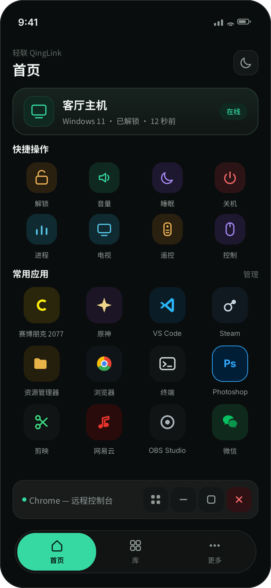
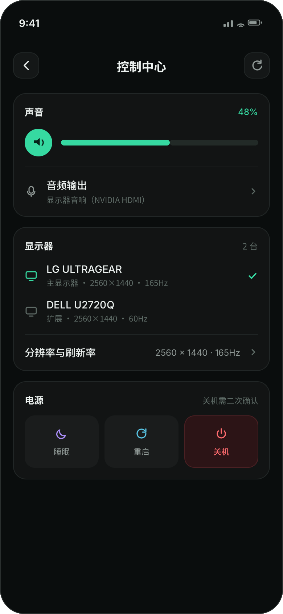
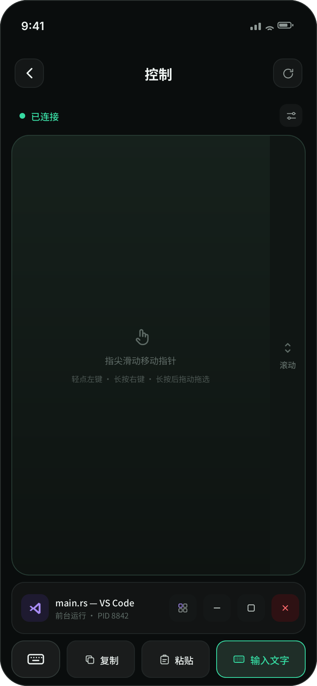
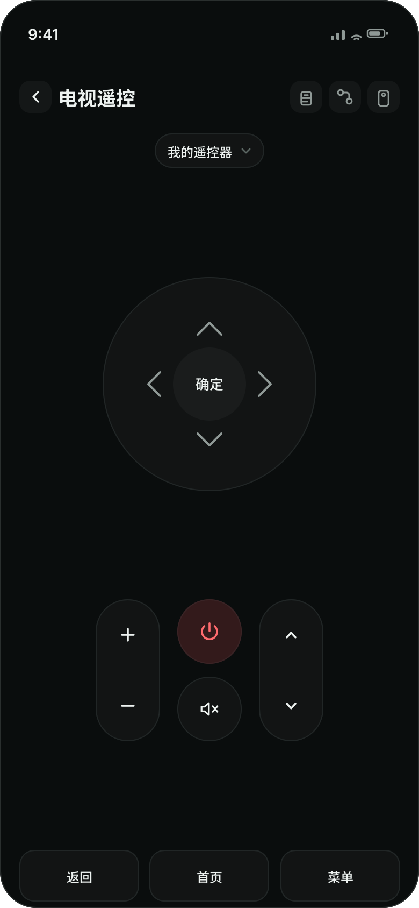

<div align="center">

# 轻联 QingLink

**在同一个局域网里，用手机控制你的 Windows 电脑。**

手机发现电脑 → 输入电脑上弹出的 6 位配对码 → 之后就能远程启动应用、管理进程、
切换显示模式、把手机当键鼠用，甚至关机重启。

<sub>免账号 · 不经公网 · 不依赖任何第三方服务器 · 数据只留在你自己的电脑上</sub>


[**下载安装**](https://github.com/fwfx1234/qinglink/releases) ·
[功能](#功能) ·
[三分钟上手](#三分钟上手) ·
[常见问题](#常见问题) ·
[从源码构建](#从源码构建) ·
[文档](#文档)

</div>

---

## 界面预览

<table>
  <tr>
    <td align="center" width="25%"><br><sub>首页 · 设备状态与常用应用</sub></td>
    <td align="center" width="25%"><br><sub>控制中心 · 显示与音量</sub></td>
    <td align="center" width="25%"><br><sub>触控板 · 手势当鼠标</sub></td>
    <td align="center" width="25%"><br><sub>红外遥控 · 手机就是遥控器</sub></td>
  </tr>
</table>

## 功能

### 操作电脑

- **触控板与键盘**：轻点左键、双指滚动、长按右键、长按拖动；手机键盘直接输入到电脑。
- **窗口与电源**：切换/最小化/最大化窗口；关机、重启、睡眠、锁屏。
- **屏幕与声音**：切换主显示器分辨率与刷新率、选择音频输出设备。
- **文件浏览**：在手机上翻电脑的目录，挑程序、挑图标、挑扫描范围，不用记路径。
- **一键复制粘贴**：在电脑上执行 Ctrl+C / Ctrl+V，不用把手机变成输入设备。

### 应用与游戏

- 自动扫描已安装程序与 Steam 游戏，也可添加自定义目录；扫描按「每个目录一个主程序」
  给出推荐项，可逐个屏蔽并随时恢复。
- 一键启动；游戏可保存主显示器启动分辨率，启动前切换、游戏退出后还原。
- **图标按条目管理**：可逐条重扫或指定图标文件，落库前统一规范为 128×128，换图标立即
  对所有客户端生效。
- 进程列表实时查看，可结束进程；结束前有确认。

### 管理电脑

- **浏览器管理界面**：内嵌在桌面端里，打开 <http://127.0.0.1:3722> 即用，浅色/深色双主题。
  应用目录增删改、重命名、隐藏、常用与置顶、批量操作、设备撤销、日志查看与下载、
  诊断包导出、链路一键修复都在这里。选文件由桌面端弹出**原生选择窗口**，不用手输路径。
- **系统托盘**：打开界面、重启服务、保持唤醒、退出；explorer 重启后自动重新注册图标。
- **日志**：界面里查最近 5000 条，同时按天写入文本日志文件，长期保留。

### 手机端

- Android / iOS 原生应用，暗色亮色双主题随系统切换。
- 可选的本机红外遥控（电视、机顶盒等），支持自定义按键与一键流程。功能入口两端都有，
  但真正发射红外需要手机自带红外发射器——没有该硬件的机型（含全部 iPhone）用不上这一块。
- **不持有业务数据**：换手机、换浏览器、换系统用户，只要连的是同一台电脑，看到的就是
  同一份应用库和同一份常用列表。

## 下载安装

### 1. 桌面端（Windows）

到 [Releases](https://github.com/fwfx1234/qinglink/releases) 下载最新的 `QingLink.exe`
（同一 Release 里的 `SHA256SUMS` 可用 `sha256sum -c` 校验完整性），双击运行，托盘出现图标
即启动完成。

首次使用需要在管理界面里安装后台服务，这一步会请求一次 UAC 提权：

1. 双击托盘图标（或左键单击）打开 <http://127.0.0.1:3722>；
2. 页面会提示「未连接到 QingLinkService」，点 **安装服务**，在 UAC 对话框点「是」；
3. 服务装到 `%ProgramFiles%\QingLink\Input`，装完页面自动恢复。

> 之后程序会在后台自动检查更新，下载完成后在「更新」页手动触发安装即可。

### 2. 手机端（Android）

下载 Release 里的 `QingLink-mobile-<版本>-android.apk` 直接安装（首次需允许「安装未知
来源应用」）。APK 由固定密钥签名，可以覆盖安装升级，**不必卸载**——卸载会清掉手机侧的
连接令牌，得重新配对一次。

> 若安装时提示「安装包未包含任何证书」，基本都是文件没下载完整：对照 Release 说明里的
> 字节数重新下载即可，与签名无关。

### iOS

本仓库不发布 iOS 包（App Store 上架与侧载都需要你自己的开发者证书）。如需使用，
按 [从源码构建](#从源码构建) 自行编译。

## 三分钟上手

1. **确认在同一局域网**：手机连的 Wi-Fi 要和电脑在同一网段，且路由器没有开启 AP 隔离。
2. **手机打开 App**，它会自动发现局域网内的电脑；点那台电脑发起配对。
3. **电脑上会弹出一个置顶小窗**，显示 6 位配对码；把它输进手机。
   （配对必须由电脑这一侧确认，所以桌面端要在运行。）
4. 配对成功后手机自动连上。验证码 60 秒失效，电脑锁屏时不会下发。

配对是一次性的：之后手机会用长期令牌自动重连，令牌保存在手机的平台安全存储里。
在管理界面的「设备」页可以随时撤销某台手机。

## 系统要求

| | 要求 |
| --- | --- |
| 电脑 | Windows 10 / 11 x64（ARM 版 Windows 未验证） |
| 网络 | 手机与电脑处于同一局域网；不需要公网、不需要端口映射 |
| 手机 | Android 7.0（API 24）及以上；iOS 需自行构建 |

## 数据与网络

**数据只有一个所有者：后台服务。桌面端和手机都只是它的客户端。** 所以换手机、换浏览器、
换系统用户，应用库与配对记录都还在。

| 端口 | 用途 |
| --- | --- |
| 3722 | 桌面端本地管理界面，**仅回环**（127.0.0.1），无认证；安全性来自「只允许本机访问」+ 服务的管道授权 |
| 3721 | 服务对外协议：控制（`/api/v2/events`）与高频输入（`/api/v2/input`） |
| 3723 | UDP 局域网发现（只广播请求，不做端口映射） |

| 数据 | 位置 |
| --- | --- |
| 应用目录、重命名、隐藏、常用与置顶、图标、已配对设备 | `%ProgramData%\QingLink\qinglink.db`（服务所有，ACL 仅 SYSTEM + 管理员） |
| 桌面端设置 | `%LOCALAPPDATA%\QingLink\qinglink.db` |
| 手机端连接信息、输入法/触控板设置、快捷键方案、红外遥控 | 手机本地（令牌在平台安全存储） |
| 日志 | `%LOCALAPPDATA%\QingLink\logs\qinglink.<日期>.log`（按天轮转，长期保留） |

`QINGLINK_DATA_DIR` 可覆盖桌面端数据目录，用于测试或便携部署。

> **⚠️ 仅用于可信局域网。** 当前版本的局域网通信**尚未启用 TLS/WSS**，配对令牌与指令在
> 局域网内是明文传输的。请只在你自己信任的家庭/办公网络里使用，**不要把 3721/3722/3723
> 暴露到公网**，也不要在公共 Wi-Fi（咖啡厅、酒店、机场）里开启配对。

## 常见问题

<details>
<summary><b>托盘图标看不见 / 找不到程序</b></summary>

Windows 会折叠不常用的托盘图标。点任务栏的 `^` 展开，把 QingLink 拖到常驻区。
若展开后仍然没有，说明进程没起来：打开终端跑一次
`QingLink.exe --self-check`，它会逐项报告托盘、日志与服务状态。

</details>

<details>
<summary><b>界面显示「服务未安装 / 未连接」</b></summary>

后台服务没装上，或刚更新过桌面端导致登记失效。在页面里点 **修复服务** 并确认 UAC 即可
——它会安装/更新随桌面端发布的那一份服务，同时重新登记桌面端身份。

</details>

<details>
<summary><b>手机搜不到电脑</b></summary>

按顺序排查：① 两端是否在同一网段（手机 4G/5G 不算）；② 路由器是否开启了「AP 隔离」；
③ Windows 防火墙是否拦截了 UDP 3723 与 TCP 3721（首次运行时会弹授权，选了「取消」就会
被拦）；④ 电脑是否休眠了。

</details>

<details>
<summary><b>手机显示「未检测到显示器」</b></summary>

显示设置读的是电脑上**真实枚举到**的模式。远程桌面/无头环境、显卡驱动异常时枚举结果为空，
属正常现象，接上物理显示器即可。

</details>

<details>
<summary><b>更新后要我重新配对 / 重新授权</b></summary>

`QingLink.exe` 一旦被重建，它的 SHA256 就变了，服务会拒绝这个「陌生」的桌面端并要求重新
登记——这是刻意设计的安全边界。点 **修复服务** 即可，不需要重新配对手机。

</details>

<details>
<summary><b>能不能在外网用</b></summary>

不能，也不打算支持。跨公网需要中继服务器或打洞，两者都会把「零账号、不经第三方」这个前提
打破。需要外网访问请自建 VPN（WireGuard、Tailscale 等），把手机接进同一虚拟局域网后
QingLink 可以照常工作。

</details>

更多排障（自检字段判读、权限级别、命名管道被拒绝、日志解读）见
[`docs/development.md`](docs/development.md) 第 4、5 节。

## 从源码构建

环境：Rust stable（edition 2024）、Node.js 20+、Windows SDK / MSVC 构建工具
（`rusqlite` 用 `bundled`，需要 C 编译器）；移动端另需 Flutter 与对应平台 SDK。

```powershell
# 1. 先生成安全输入服务资源（构建产物，不入库，全新 clone 必须做一次）
cargo build -p qinglink-service --bin QingLinkService
Copy-Item .\target\debug\QingLinkService.exe .\apps\desktop\assets\input\QingLinkService.exe -Force

# 2. 构建并运行桌面端；会自动构建并内嵌 Web 界面
cargo run --bin QingLink
```

`QingLink.exe` 是单文件分发：Web 界面与安全输入服务都已内嵌。跳过第 1 步程序照样能跑，
但「安装服务」会提示「未内嵌安全输入服务」。

```powershell
# 移动端
cd apps\mobile
flutter pub get
flutter run
```

发布构建、签名、版本号构成、CI 流水线与内嵌资源的刷新顺序见
[`docs/development.md`](docs/development.md)。本仓库**不提供构建脚本**，跨语言编排全部由
[`apps/desktop/build.rs`](apps/desktop/build.rs) 承担，日常只用 `cargo` / `npm` / `flutter`
的原生命令（见 [`AGENTS.md`](AGENTS.md) §7）。

## 项目结构

```
crates/          Rust 库：协议 DTO、领域模型、Windows API 封装、服务端、发现、UI 组件
services/        安全输入服务（LocalSystem，提供登录前令牌认证与安全桌面输入）
apps/desktop/    桌面端（托盘 + 本地管理面）+ 内嵌的 Vue 3 管理界面
apps/mobile/     Flutter 手机端
protocol/        跨语言协议契约：v2 语义、请求索引、JSON Schema、共享夹具
docs/            架构、接口、开发与设计规格
```

完整模块划分、线程模型与设计取舍见 [`docs/architecture.md`](docs/architecture.md)。
QingLink 是独立项目，不依赖 QingQi crate，也不向 QingQi 主程序加载远控插件。

## 文档

| 文档 | 内容 |
| --- | --- |
| [`docs/architecture.md`](docs/architecture.md) | **结构总纲**：组件、数据归属、桌面端进程模型、托盘与日志子系统、关键时序 |
| [`docs/web-api.md`](docs/web-api.md) | **桌面管理接口契约**：REST 端点、WebSocket 事件、错误码、前端约束 |
| [`docs/development.md`](docs/development.md) | 构建、运行、`--self-check` 自检、排障、改动约定 |
| [`protocol/v2.md`](protocol/v2.md) | 手机与电脑之间的协议（配对、发现、控制） |
| [`protocol/requests.md`](protocol/requests.md) | 上行请求索引：95 个请求类型的线格式名、载荷字段与错误码 |
| [`protocol/README.md`](protocol/README.md) | 跨语言 DTO 说明与 schema / fixtures 的使用方式 |
| [`apps/mobile/README.md`](apps/mobile/README.md) | 手机端配对、设置与开发说明 |
| [`docs/design/DESIGN-SPEC.md`](docs/design/DESIGN-SPEC.md) | 界面规格：颜色令牌、字号、尺寸与屏 → 代码映射 |
| [`AGENTS.md`](AGENTS.md) | **工程约束**：行数上限、文档同步映射、测试策略、完成定义 |
| [`agent.md`](agent.md) | 代码审查口径：分级表、输出格式与升级条件 |

## 贡献与许可

- 提交前请先读 [`AGENTS.md`](AGENTS.md)——本项目对文件规模、文档同步与测试策略有硬性约定。
- 哪些功能被**刻意放弃**（以及原因），见 [`docs/architecture.md`](docs/architecture.md) §11。
- 未附许可协议：本仓库目前**未声明开源许可**，默认保留所有权利。如需在自有项目中复用，
  请先开 Issue 说明用途。
